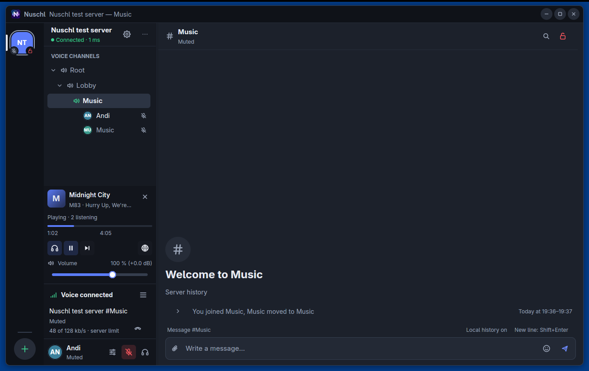
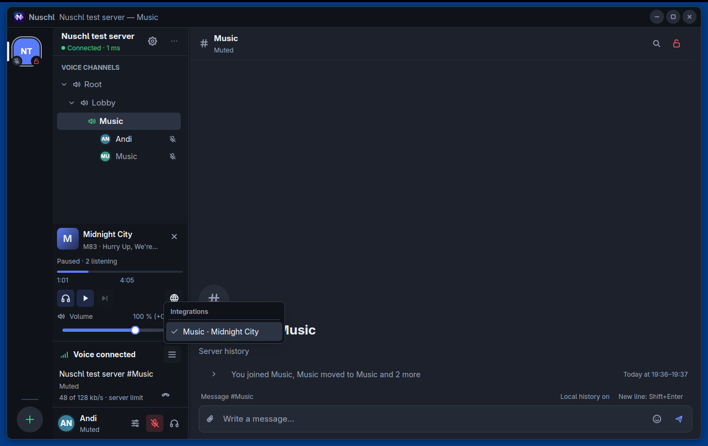
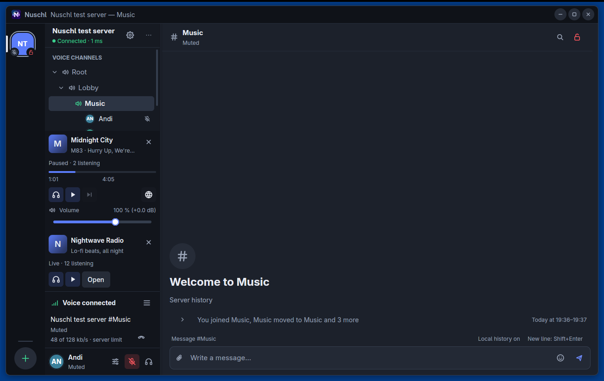
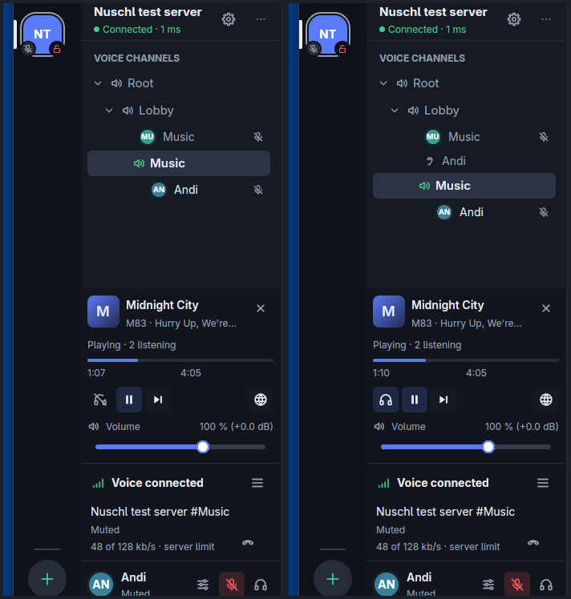

# Integration surfaces: the UI kit and the music bot card

2026-11-27. The first slice of [#203](https://github.com/nuschl-eu/nuschl/issues/203):
a bot publishes a small card that every client draws with native widgets, and
the music bot is the first producer. The wire types live in
`crates/core/src/integration.rs`, the client store in
`crates/client/src/client/integration.rs`, the music bot's card in
`apps/musicbot/src/integration.rs` and the desktop card in
`apps/desktop/src/integrations.rs`.

## Screenshots

`tests/integration_screenshots.py --dismiss --stack` produced these against a
loopback `nuschld`, in a private headless GNOME Shell:



The picker in the voice card's heading names itself, lists one row per card and
stays open while they are toggled; a hidden card takes no room:



Two bots, a card each, and the channel list gives up the height they take:



The bot moved out of the user's channel: the card stays, its listen control
turns off, and one press listens into the bot's channel. The channel tree then
shows the same user under both channels, which is what a stock Mumble client
draws too:



## Model

A bot publishes a **surface**: a full snapshot of a closed set of nodes, with a
strictly increasing revision. The client keeps the newest revision per sender
and surface, draws the nodes in order, and drops the card when its sender's
presence goes. Nothing is executed, fetched or styled by the sender; icons come
from the client's own set.

A surface is a full snapshot: the sender describes content and order, and each
client chooses the exact layout. Text is plain UTF-8 in one of three styles.
Unknown node kinds, flags, styles and icons are refused whole, and a malformed
snapshot leaves the previous card in place.

## Transport

For this slice a surface travels as Mumble plugin data, which stock Murmur and
`nuschld` forward to the listed sessions:

| Direction | Data ID | Longest |
| --- | --- | --- |
| bot → client | `nuschl/kit/1` | 960 bytes |
| client → bot | `nuschl/kit-action/1` | 32 bytes |
| bot → one client | `nuschl/kit-link/1` | 512 bytes |

Both IDs are in the reserved `nuschl/` namespace and never reach the generic
plugin-data API: the session lets exactly the three UI IDs through in each
direction and drops every other reserved ID, and the client reads `nuschl/kit/1`
into its surface store. `nuschld` relays them with the same checks as any plugin
data; an end-to-end server forwards none of it and carries surfaces as MLS
application messages instead (under Retention).

The bot chooses its audience. The music bot sends to the presences in its
channel and to those listening to it, in as many messages as the session's
128-receiver bound needs, and answers a newcomer with the current revision. Other integrations may push, pull or
answer commands; the kit leaves the choice to them.

What a listed session receives differs by server. Murmur forwards plugin data to
every connected, authenticated session, whatever its channel, permissions or
relation to the sender (`crates/protocol/src/plugin.rs` records its rules).
`nuschld` delivers a surface between sessions that see each other
(`apps/server/src/handlers.rs`), which is what keeps a hidden channel's occupants
hidden (`docs/server.md`). Both rules answer who sees, so a moderator who sees a
hidden channel receives its bot's card without hearing that bot.

## State and updates

The bot owns the card's state. `nuschld` forwards surfaces and stores no
content; a client keeps the newest revision it received and replaces it
wholesale.

- A newer revision replaces an older one for the same `(sender, surface id)`.
- A sender's new presence starts from no revision; the old card goes.
- An empty surface withdraws the card, and only one newer than the revision the
  sender published: a late or duplicated withdrawal leaves the card up.
- A connection ending clears its cards.
- At most 64 surfaces are kept per server; the oldest announcement goes first.

The bot sends a new revision when the song, pause state, buffering state or
listener count changes, and to a listener who just arrived. The playing
position alone never sends anything.

## Progress

`Progress { position_ms, duration_ms, advancing }` carries a baseline.
`position_ms` is where the song was when the bot built the revision; while
`advancing`, the client adds the time since it received that revision and caps
the result at `duration_ms`. A paused or buffering card holds its position, and
a client that joins mid-song starts from the position in the snapshot it gets.

The desktop repaints the bar once a second while a card advances; no message
goes over the network for it.

## Actions

A press names the sender that drew the card, the surface, the revision it was
drawn from, the control id and an idempotency key. Two bots may publish the same
surface id, so the sender is part of the identity the client matches, and the bot
drops a repeat of the last key it applied.

```text
Action { surface, revision, control, key }
```

The bot refuses a press for another revision, a repeat of the press it applied
last, a presence that is not a listener, or an unknown control. The client
refuses to send a press for a surface it no longer holds. The music bot's controls are `1` (play/pause) and
`2` (next); a new revision follows the state change.

## Drawing

The desktop draws up to two cards between the channel list and the voice status,
so the list gives up the height they take; the rest wait until one is hidden. A
card is artwork, title, subtitle, its remaining nodes in order, and a close
button. It is a plain sidebar panel: the client's own fill, no outline, with
rounding only on what is inside it (the artwork tile, the transport buttons, the
progress bar).

Hiding is the user's, not the bot's, and a hidden card takes no room at all: the
channel browser gets its space back. The way back is the integrations picker
behind the button at the right of the voice card's heading, which lists one row
per card with a check while it is shown. The picker stays open across toggles,
so several cards are hidden or shown in one visit; it closes on Escape or a
press outside it. The desktop keeps the hidden set for its session, keyed by
server, sender account (or presence) and surface id, and a new revision of a
hidden surface stays hidden.

## Volume

`Volume` asks the client to draw its own control for the sender's playback
level. The wire carries no value: the slider edits this client's per-user
setting (`nuschl_client::native::UserKey`, the certificate when the server gave
one and the presence otherwise), takes effect locally on the next frame, and
never sends a message. A bot therefore neither learns nor sets the level, and a
client that does not draw the node loses nothing.

## Listening

The first control of a card is the headphones one, and it belongs to the client:
a press never becomes a message to the bot. It listens into the channel the
sender speaks in, the same `Command::Listen` the channel menu sends and the same
`listening_channel_add` a stock client understands. The control reads on while
the user is in that channel or already listening to it, off otherwise, and dim
while the server's cached permissions do not allow the listen. Nothing about it
is on the wire: the bot publishes the button like any other and learns neither
who listened nor that anyone pressed it.

Who may listen is who sees the channel, in the client and in the server. The
control lights up only for a channel this client sees, and `nuschld` drops a
listen into a channel hidden from the user who asked (`apps/server/src/handlers.rs`)
together with any listen the `Listen` permission denies; a hidden channel's
occupants never reach the client's list, so a bot in one has no card to offer. On
an MLS server the same rule comes from the group: a device reads a channel's
audio because it is a member, and the server removes a device whose account may
no longer read the channel (`apps/server/src/mls.rs`). Listening counts as
reading (`apps/server/src/authz.rs`), so a listener is a reader of that channel's
group as well.

## Ducking

Speech lowers a bot's playback on both sides, each counting only what it already
has. The bot lowers its own output when someone speaks in its channel, which
also works on a stock Mumble server. The client half comes with the next slice:
it scales the integration sender's level while anyone else speaks in a channel
it receives, on top of the per-user slider and without a setting or a message. Each side works on its own: the bot is usable with stock
clients, and the client ducks a bot that does its own ducking as well.

## Pages

A bot may publish a control with the `web` icon for its own page. The press
reaches the bot, because the page carries a token minted for this user and only
the bot can mint it; the bot answers with one `nuschl/kit-link/1` message to that
session, and the client opens it. `nuschl_core::integration::link` bounds what
may arrive: one line, at most 512 bytes, and `http` or `https` (`crate::allowed_link`'s
scheme rules). The client opens a link only when it pressed a `web` control of
that sender's live card within the last 30 seconds, and only once per press, so a
bot cannot open a browser on its own. A control with another icon never asks for
a link.

The control sits at the right of the card's transport row, which the card
already draws: it adds no height.

## Nodes and bounds

| Node | Fields | Bound |
| --- | --- | --- |
| Text | style (title, subtitle, body), text | 160 bytes each; 512 bytes a surface |
| Progress | position, duration, advancing | one line, no sub-second ticks |
| Buttons | id (1 byte), icon, label, enabled | 4 a node, 8 a surface, ids unique per surface, 24-byte labels |
| Volume | none: the client draws its own per-user level | client-side, no message |

Icons are `none`, `play`, `pause`, `next`, `previous`, `headphones` and `web`.
The client draws them from its compiled assets; the sender never supplies an
image. `none` is a control with a label and no icon, drawn as a text button.
`headphones` is the client-owned listen control described above, so its id
carries no meaning to the sender. Ids are unique per surface because an action
names the control id alone, and numbers are the shortest varint encoding of
their value, so two senders of one snapshot produce the same bytes. A surface holds at
most 8 nodes and 960 encoded bytes, which fits Murmur's 1,000-byte plugin-data
limit.

## The music bot

The card shows the current track's title, artist (or album), a line with
`Playing`, `Paused` or `Buffering…` and the listener count, the progress
baseline and two buttons. It is published from the bot's Mumble session to the
people who can hear that session:

- a track, pause, buffering or listener-count change sends a new revision;
- a new listener receives the current revision;
- nothing plays: an empty surface withdraws the card;
- a press is applied to the player, and the resulting state change publishes the
  next revision.

The bot accepts plugin data on its connection and reads only
`nuschl/kit-action/1`. It does not read messages for the card, and the card
carries no message content. Its controls are `1` (play/pause), `2` (next) and
`3` (the page): the button and the `!web` message share one minting path, so both
hand out the same link and `!web new` replaces it for the button too. The command
becomes `/web` when the bot's commands move to the slash form.

## Retention (proposed, not in this slice)

Live state and message content stay apart. A card is live state: it belongs to
the sender's presence and is not stored. Message content is a message and
follows the conversation's retention, edits and deletes. Native polls are a
server feature; a bot-run poll would post a message and keep its tally as live
state.

A long-lived bot is the awkward case: when it restarts or goes missing, every
client loses the card, including one that joins afterwards. The proposal is that
the server keeps the newest surface per `(account, surface id)`, only for
surfaces the bot marks retained:

- authorship binds to the account the server attested, never to a session; a
  connection replaces only its own account's copy;
- the copy carries the server's `stored_ms`, so a client can say "last updated
  …" and stop interpolating progress once it is stale, instead of advancing a
  bar for a bot that is gone;
- a new presence of the same account replaces the copy whatever its revision,
  because a restarted bot counts revisions from the start again;
- caps and expiry belong to the server: a kilobyte per surface, a handful per
  account, hours rather than days;
- the audience is the open question. Today the bot chooses its recipients, and
  a retained copy has none. Either the copy records the channel the bot
  published in and is served to whoever may read that channel, or a retained
  surface is readable by everyone on the server. An MLS server answers this with
  the conversation's history policy (below); a legacy server has neither history
  keys nor ciphertext, so the channel is the answer there;

### Nuschl servers (MLS)

An end-to-end server forwards no plugin data (`apps/server/src/handlers.rs`), so
a surface there takes the path messages take: an MLS application message whose
Nuschl envelope names a new kind, one more variant of `Kind` in
`crates/e2ee/src/envelope.rs` (`docs/e2ee.md` §6.4). The card's bytes sit inside
the ciphertext and the server relays a row it cannot read.

Storage is the second axis, and `docs/e2ee.md` §6.6 already separates it: the
application message is the live copy, and the durable copy is an archive record
sealed under the conversation's history key chain (`crates/e2ee/src/client.rs`
holds the key), its hash in the envelope (`ChatSend.archive`). A device that
joins later reads it through a `history_grant`, under the conversation's policy,
so a kept surface reaches exactly the devices that may read the channel's
history. Neither the card's
content nor its audience needs a rule of its own.

- A live card is the live copy: a revision costs one stream row, which the server
  drops once every member device has it, and no archive record.
- A surface that has to outlive its bot is also an archive record. Progress never
  writes one: the bot archives the revisions that matter (track, pause, queue)
  and the client interpolates the bar from those.
- `live_only`, on the server or the channel (`nuschl.proto`), keeps nothing, so
  the card is a stream event there and a newcomer asks the bot.
- The envelope's `sent_at` is the sender's, inside the ciphertext; a row's arrival
  time is the server's unauthenticated hint beside it.

Until a server keeps the copy, the bot answers a newcomer with the current
revision, which is what the music bot does.

## What the next slice adds

The node set is the extension point. Images through the content worker, lists,
select menus, inputs and per-user surfaces each add a node or a field with their
own bounds. A Nuschl-server registry, channel scopes and attested actors sit
above the same wire format, and an `integrations/1` server capability can carry
it with larger budgets. The music bot needs none of that to work.

## Tests

- `nuschl-core`: round trip, size, malformed input, text and button bounds,
  ids unique across a surface's button nodes, and varints that are only the
  shortest encoding of their value.
- `nuschl-client`: revision ordering, presence changes, a withdrawal only from a
  newer revision, a press to the exact sender that drew the card, the
  stale-revision refusal, a kit press's admission staying out of the generic
  plugin-data queue, a page opening only after the press that asked for it, and
  a link that is not a web page opening nothing.
- `nuschl-session`: the three UI IDs are the only reserved data that reaches the
  client, in both directions.
- `nuschl-musicbot`: the existing suite, including the merged DJ, queue and
  playlist work, plus the card's text sanitising, one action per key, the page
  control answering as its own press kind, and a listener list that spans more
  than one message.
- `tests/integration_screenshots.py` (local-only: a private headless GNOME
  Shell on the host GPU): a loopback `nuschld`, scripted bots and the desktop in
  one channel. It presses the listen control and asserts the bot receives
  nothing, presses the card's pause button and decodes the action the bot
  receives, publishes the paused revision (a held progress baseline and a
  disabled control), moves the bot to another channel and listens into its
  channel with the control that turned off, then opens the picker and hides and
  shows the card through it, and stacks a second bot's card whose label-only
  control it presses and decodes. The screenshots are the evidence for the
  layout:

      PATH=<imagemagick>:$PATH NUSCHL_WL_TMP=/tmp \
        python3 tests/integration_screenshots.py <binaries> --output DIR \
          --gnome-shell <gnome-shell> --pulse-bin <pulseaudio> --dismiss --stack
